<div align="center">


# ToDo

### A lista de tarefas que se limpa sozinha.

O que não recebe atenção em 3 dias sai do caminho.<br>
A tua lista mostra só o que ainda importa, sem se tornar um arquivo de coisas por fazer.

[](https://github.com/hroxo/todo/actions/workflows/ci.yml)
[](#instalar-no-iphone)
[](#arquitetura)
[](https://github.com/hroxo/todo/releases/tag/ultima)
[](LICENSE)

<a href="docs/media/ToDo-promo.mp4">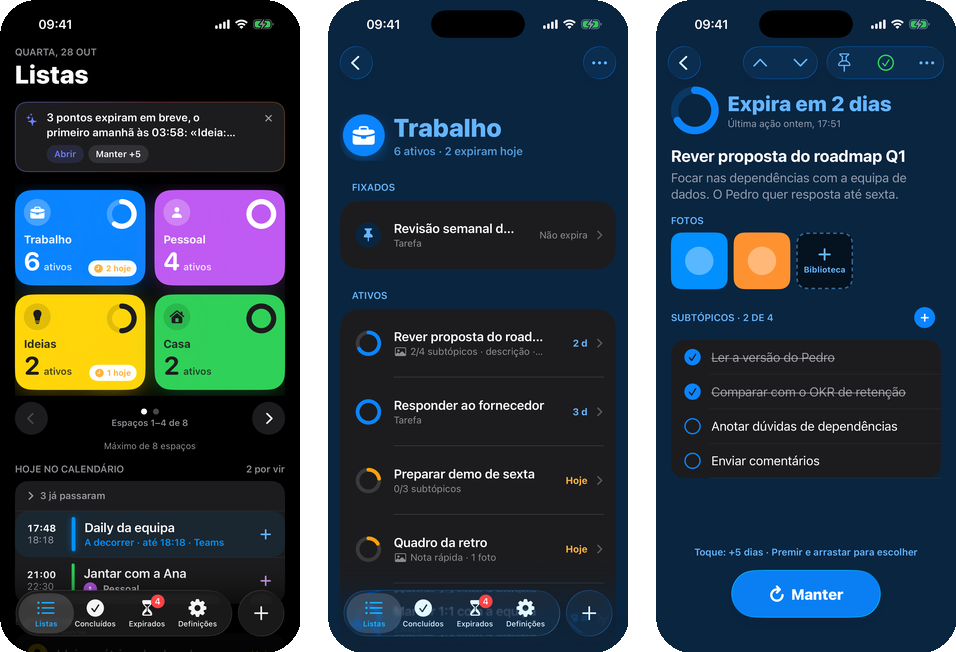</a>

### ▶️ [Ver o vídeo de demonstração](docs/media/ToDo-promo.mp4)

</div>

---

## Porquê

As apps de tarefas crescem até ninguém as abrir. Cada ideia fica lá para sempre, e a lista deixa de dizer o que é importante.

O **ToDo** inverte isto: **cada ponto tem 3 dias de vida.** Se lhe tocas (editas, marcas um subtópico, acrescentas uma foto), o prazo recomeça. Se ainda importa mas não é para já, **Manter** dá-lhe mais tempo. Se não lhe tocas, sai da lista, mas fica 14 dias em **Expirados**, à espera, caso mudes de ideias.

- 🧹 **Dinâmica, não arquivo**: a lista ativa só tem o que ainda importa.
- 🛟 **Nada se perde por engano**: o que expira é recuperável.
- ⚡ **Registar em segundos**: escrever e guardar, com o teclado já aberto.
- 🔒 **Tudo no teu iPhone**: sem servidor e sem custos. Ligar uma conta Google ou Outlook é opcional e só lê o calendário.
- ✨ **Simples e bonita**: nativa, com o liquid glass do iOS 26 e cores com significado.

## Funcionalidades

<table>
<tr>
<td width="50%" valign="top">

### ⏳ Um anel que conta o tempo
Cada ponto mostra um anel que se esvazia nos 3 dias e fica laranja no último. O Início junta o que expira hoje.

</td>
<td width="50%" align="center">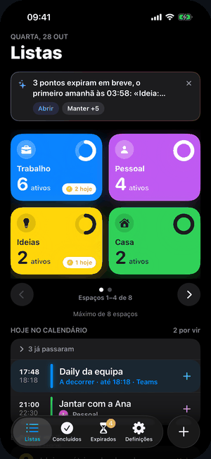</td>
</tr>
<tr>
<td align="center">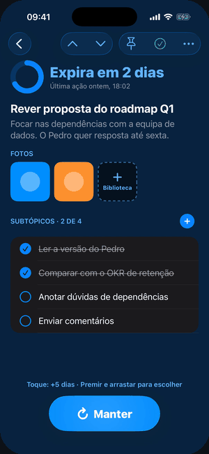</td>
<td valign="top">

### 💧 Manter, num gesto
Um toque dá **+5 dias**. Prime e arrasta: a gota de vidro divide-se em **+5** e **+15**, e soltas para escolher. Também funciona a partir da notificação, sem abrir a app.

</td>
</tr>
<tr>
<td valign="top">

### 📅 O teu dia ao lado das listas
Liga o calendário (Apple, Google, Outlook: as contas que já tens no iPhone, ou uma conta Google ou Outlook ligada na app) e vê os eventos de hoje no Início, cada um no seu espaço ou sem espaço. Toca num evento para ver os participantes, as notas do convite e o link da reunião. Um **+** transforma um evento num ponto, uma vez só.

</td>
<td align="center">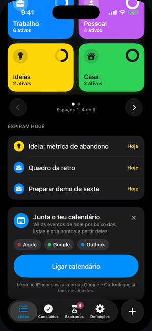</td>
</tr>
<tr>
<td align="center">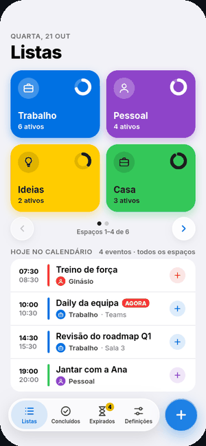</td>
<td valign="top">

### 🗂️ Até 8 espaços
Trabalho, Pessoal, Casa… cada espaço tem a sua cor e um ícone ou emoji. Com mais de 4, o Início mostra páginas com setas.

</td>
</tr>
<tr>
<td valign="top">

### 🌗 Claro ou escuro, como o teu iPhone
A app segue o tema do sistema, e o ícone também tem versões escura e tingida.

</td>
<td align="center">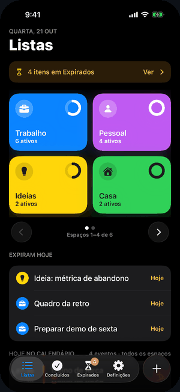</td>
</tr>
</table>

E ainda:
- **Concluir num toque**: toca no anel de um ponto e está feito, com **Anular** durante 4 segundos.
- **Subtópicos**: quando os concluis todos, a app sugere concluir o ponto.
- **Passar de ponto em ponto** no detalhe, com ˄ ˅ ou puxando nas pontas do ecrã.
- **Descrição curta** e até **4 fotos** em cada ponto.
- **Fixar** o que nunca deve expirar.
- **Captura rápida**, com subtópicos, fotos e escolha do espaço.
- **Concluídos** durante 7 dias, para reabrir se for preciso, com **filtros** por espaço e por data (também em Expirados).
- **Exportar CSV** de um espaço ou de tudo, pronto a abrir no Excel ou no Numbers.
- **Notificações** 24 horas antes de um ponto expirar (nunca durante a noite).
- Cada gesto tem uma alternativa por menu, e a app suporta Dynamic Type e VoiceOver.

## Galeria

| | Início | Lista | Detalhe | Captura | Expirados | Definições |
|---|---|---|---|---|---|---|
| **Escuro** | 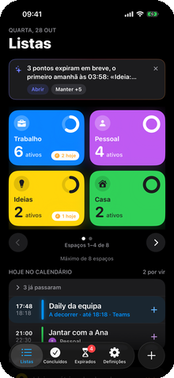 | 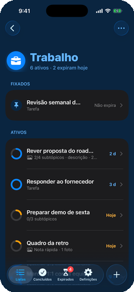 | 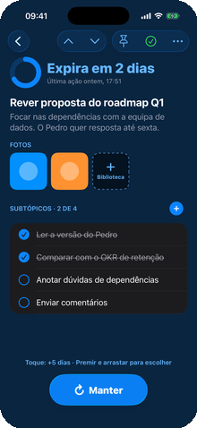 | 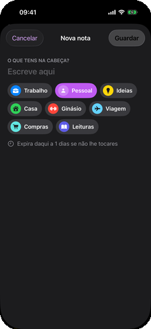 | 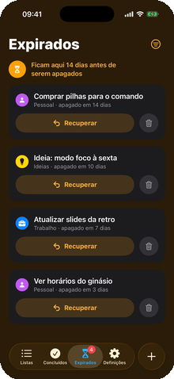 | 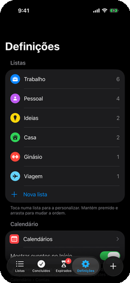 |
| **Claro** | 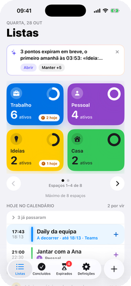 | 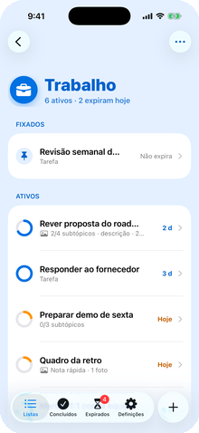 | 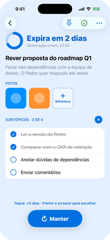 | 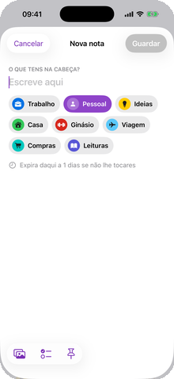 | 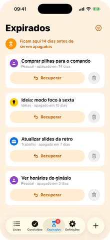 | 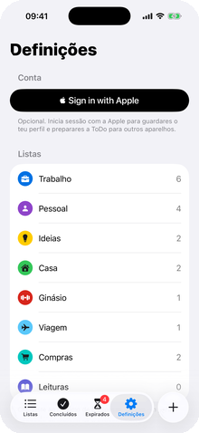 |

<sub>Capturas reais do simulador, tiradas pelo CI em cada versão.</sub>

## Como funciona

| Regra | |
|---|---|
| Ponto novo | Fica **ativo durante 3 dias** |
| Tocar num ponto (editar, subtópico, foto, descrição) | O prazo **recomeça**: mais 3 dias |
| **Manter** | **+5 dias** (toque) ou **+15 dias** (arrastar), a contar de agora |
| **Fixar** | Nunca expira |
| Sem ações até ao fim do prazo | Vai para **Expirados**, onde fica **14 dias** e se pode recuperar |
| **Concluir** | Vai para **Concluídos**, onde fica **7 dias** e se pode reabrir |

Todas as durações podem ser mudadas em Definições › Avançado › Prazos.

## Instalar no iPhone

A app é para uso pessoal e não está na App Store. Cada versão é compilada pelo CI e publicada como `.ipa`.

**Precisas de:** um iPhone com iOS 26 ou superior, um cabo USB, um computador (Windows, Linux ou macOS) e um Apple ID gratuito. Recomenda-se um Apple ID só para isto, mas não é obrigatório.

1. **[Descarrega `ToDo.ipa`](https://github.com/hroxo/todo/releases/download/ultima/ToDo.ipa)** (última compilação).
2. Segue os passos do teu sistema, abaixo.
3. Faz os [passos no iPhone](#passos-no-iphone) e abre a app.

Em todos os sistemas usamos o [iloader](https://github.com/nab138/iloader), que assina a `.ipa` com o teu Apple ID e a instala por cabo.

<details>
<summary><b>🪟 Windows</b></summary>

1. Instala o **iTunes** (do [site da Apple](https://www.apple.com/itunes/) ou da Microsoft Store) ou a app **Dispositivos Apple**. Fornece os controladores USB para o PC reconhecer o iPhone.
2. Descarrega o instalador do iloader (`.exe` ou `.msi`) em [Releases](https://github.com/nab138/iloader/releases) e instala-o.
3. Liga o iPhone ao PC por cabo, desbloqueia-o e toca em **Confiar neste computador**.
4. Abre o iloader e inicia sessão com o teu Apple ID. Se tiveres verificação em dois passos, introduz o código.
5. Escolhe o iPhone, usa a opção de instalar uma `.ipa` e seleciona o `ToDo.ipa` descarregado.

</details>

<details>
<summary><b>🍎 macOS</b></summary>

1. Descarrega o iloader (`.dmg`) em [Releases](https://github.com/nab138/iloader/releases): escolhe `aarch64` para Macs com chip Apple (M1 ou posterior) e `x64` para Macs Intel. Arrasta-o para Aplicações.
2. Se o macOS bloquear a abertura, vai a Definições do Sistema › Privacidade e Segurança e escolhe **Abrir mesmo assim**.
3. Liga o iPhone por cabo, desbloqueia-o e toca em **Confiar neste computador**. Não precisas de instalar mais nada.
4. Abre o iloader, inicia sessão com o teu Apple ID e escolhe o iPhone.
5. Usa a opção de instalar uma `.ipa` e seleciona o `ToDo.ipa`.

> Se tiveres o Xcode, também podes instalar a `.ipa` com o Apple Configurator, mas ele só aceita `.ipa` assinadas. Por isso o iloader é o caminho mais simples.

</details>

<details>
<summary><b>🐧 Linux</b></summary>

1. Instala o `usbmuxd`, que fala com o iPhone por USB (costuma já vir instalado):
   ```bash
   sudo apt install usbmuxd          # Debian / Ubuntu
   sudo dnf install usbmuxd          # Fedora
   sudo pacman -S usbmuxd            # Arch
   ```
2. Descarrega o iloader em [Releases](https://github.com/nab138/iloader/releases) no formato da tua distribuição (`.AppImage`, `.deb` ou `.rpm`).
3. Se usares AppImage, torna-o executável e corre-o:
   ```bash
   chmod +x iloader*.AppImage
   ./iloader*.AppImage
   ```
4. Liga o iPhone por cabo, desbloqueia-o e toca em **Confiar neste computador**.
5. No iloader, inicia sessão com o teu Apple ID, escolhe o iPhone, instala uma `.ipa` e seleciona o `ToDo.ipa`.

</details>

### Passos no iPhone

1. **Modo de Programador:** em Ajustes › Privacidade e Segurança › **Modo de Programador**, ativa e reinicia o iPhone. A opção só aparece depois de uma primeira instalação.
2. **Confiar no programador:** em Ajustes › Geral › VPN e Gestão de Dispositivos, toca no teu Apple ID e em **Confiar**.
3. Abre o **ToDo** e permite as notificações.

### Atualizar e renovar

> Com um Apple ID gratuito, a assinatura dura **7 dias**. Passado esse prazo a app deixa de abrir: volta a instalar a `.ipa` com o iloader (a mesma ou uma nova). Os dados mantêm-se. Também há um limite de 3 apps instaladas assim ao mesmo tempo.

Para não dependeres do computador todas as semanas, podes instalar o [SideStore](https://sidestore.io), que renova a assinatura no próprio iPhone, e depois instalar o `ToDo.ipa` por lá.

### Problemas comuns

| Sintoma | O que fazer |
|---|---|
| O iloader não encontra o iPhone | Desbloqueia o telemóvel, confia no computador, experimenta outro cabo ou porta. No Windows, confirma que o iTunes ou os Dispositivos Apple estão instalados. No Linux, confirma que o `usbmuxd` está a correr. |
| «Programador não fidedigno» ao abrir | Faz o passo 2 de [Passos no iPhone](#passos-no-iphone). |
| A opção Modo de Programador não existe | Instala primeiro uma app com o iloader; a opção aparece a seguir. |
| A app deixou de abrir | A assinatura expirou: reinstala. |

## Arquitetura

```
ToDo
├── App/                     Interface SwiftUI (ecrãs, componentes, notificações, calendário)
│   └── Resources/           Catálogo de cores (12 × 4 variantes) e ícone
├── Packages/ToDoCore/       Núcleo sem interface: modelos SwiftData, regras, testes
├── design/                  Guia de UI (DESIGN.md), ícone e mocks
├── scripts/                 Capturas de ecrã, mocks e imagens do README
└── project.yml              Projeto Xcode gerado pelo XcodeGen
```

- **SwiftUI** com liquid glass (`glassEffect`, `GlassEffectContainer`), **SwiftData** com o esquema versionado e migrações testadas, **EventKit** só para leitura, **UserNotifications** com ações, **PhotosPicker**.
- **O núcleo é testado à parte** (`swift test`): cada regra do produto tem testes, com um relógio injetável para as datas.
- **Sem dependências externas.**

## Desenvolvimento

Não é preciso Xcode local: **o CI é o compilador.**

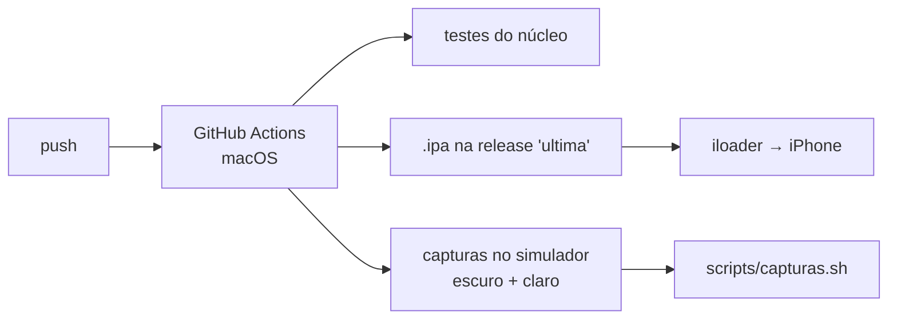

| Script | O que faz |
|---|---|
| `scripts/capturas.sh` | Descarrega as capturas do CI para `capturas/<versão>-<commit>/` (guarda as anteriores) |
| `scripts/mocks.sh` | Converte os mocks HTML de `design/mocks/html/` em PNG |
| `scripts/readme-media.py` | Gera as imagens e os GIFs deste README a partir das capturas |

A app tem um **modo de demonstração** (`-demo YES -ecra <nome>`), com dados de exemplo em memória, que o CI usa para fotografar cada ecrã.

## Roadmap

- [x] **M0** Pipeline: compilação no CI e instalação no iPhone
- [x] **M1** Listas, pontos, subtópicos, menu "…"
- [x] **M2** Expiração, Manter, notificações
- [x] **M3** Expirados, Concluídos, Definições, captura rápida e design
- [x] **M4** Descrição curta, Definições reorganizadas
- [x] **M5** Calendário (EventKit), espaços em páginas, calendário por espaço
- [ ] **M6** Importar CSV e backup JSON
- [ ] **M7** Acabamento visual, háptica e acessibilidade

## Design

O guia de UI está em [`design/DESIGN.md`](design/DESIGN.md) e os mocks em [`design/mocks/`](design/mocks). O ícone, *três linhas de lista que encolhem e desvanecem*, conta a ideia da app: a lista que se limpa sozinha.

<p align="center"></p>

## Licença

[MIT](LICENSE) © 2026 Hugo
