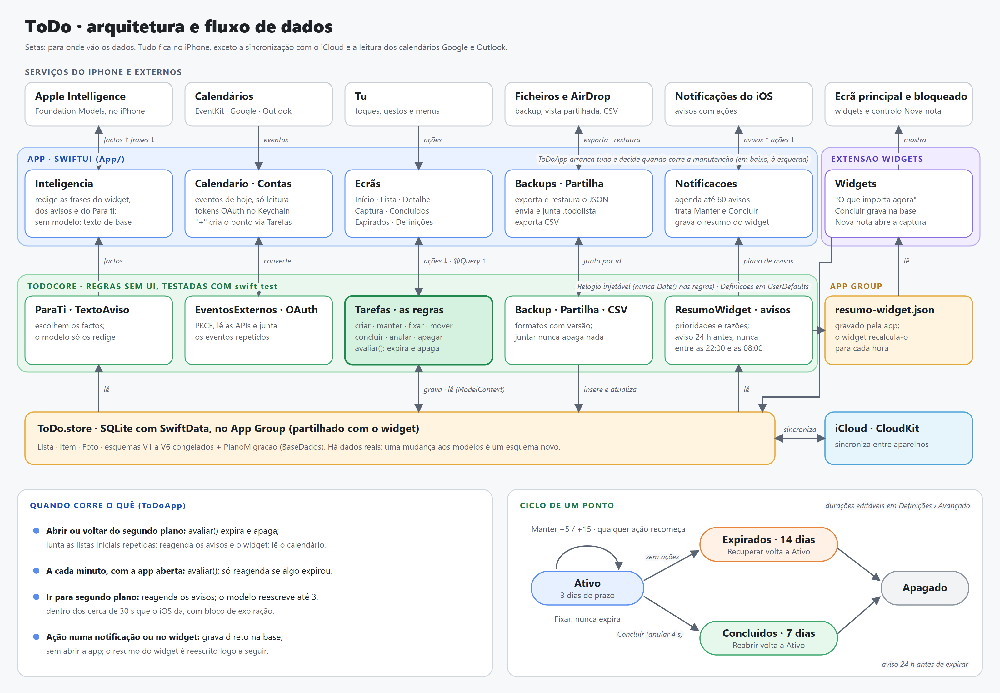

# Arquitetura

Visão técnica do ToDo para quem vai mexer no código. O desenho visual está em [`design/DESIGN.md`](../design/DESIGN.md); o dia da conta Apple paga está em [`CONTA-DEVELOPER.md`](CONTA-DEVELOPER.md).



O desenho é gerado a partir de [`media/arquitetura.svg`](media/arquitetura.svg). Depois de o editar, exporta o PNG com o Edge (ou o Chrome) sem janela:

```sh
msedge --headless=new --hide-scrollbars --force-device-scale-factor=2 --window-size=1600,1110 \
  --screenshot=docs/media/arquitetura.png file:///<caminho>/docs/media/arquitetura.svg
```

## Camadas

```
App/ (SwiftUI)              ──usa──▶  Packages/ToDoCore (Swift puro + SwiftData)
  Ecras/         ecrãs                   Modelos.swift      Lista, Item, Foto, enums (esquema V6)
  Componentes/   peças reutilizáveis     Tarefas.swift      operações e regras (expiração, listas vazias…)
  Contas/        OAuth, Keychain, Apple  BaseDados.swift    esquemas V1–V6, migrações, contentor
  Inteligencia/  modelo do iPhone        Prazo.swift        tempo restante, rótulos, anel
  Calendario     EventKit + externos     Definicoes.swift   durações e avisos (UserDefaults)
  Notificacoes   avisos + widget         TextoAviso.swift   textos dos avisos
  Backups        ficheiros e iCloud      ParaTi.swift       cartão "Para ti" do Início
  Demo           dados de exemplo        ResumoWidget.swift prioridades e resumo para o widget
                                         TemaMascote.swift  tema da Ampulheta (trabalho, pessoal, viagem…)
Widgets/ (extensão WidgetKit)            Partilha.swift     vista partilhada em ficheiro .todolista
  ToDoWidgets    widgets e controlo      Backup.swift       formato JSON e restauro
  VistaWidget    vistas (também na app)  Filtro/Exportador/Espacos/Navegacao/OAuth/Reunioes…
  Mascote        a Ampulheta (Canvas)
  Intents        concluir, nova nota
```

A UI não contém regras: chama `Tarefas` (que recebe `ModelContext`, `Relogio` e `Definicoes`). O núcleo compila e testa-se sem simulador (`swift test` em `Packages/ToDoCore`).

## Projeto (XcodeGen)

`project.yml` gera o `ToDo.xcodeproj`, os `Info.plist` e as `.entitlements` (todos fora do git). Ao criar um ficheiro novo, correr `xcodegen generate`.

- **Target `ToDo`** (app, iOS 26). Declara:
  - o tipo `.todolista` (`UTExportedTypeDeclarations` e `CFBundleDocumentTypes`);
  - o esquema de URL `todo://` (`todo://captura` abre a captura);
  - o App Group `group.com.hugo.tudo`.
  - As capacidades da conta paga (iCloud/CloudKit, `aps-environment`, Sign in with Apple) estão escritas e comentadas.
- **Target `ToDoWidgets`** (app-extension, embutida na app). A app também compila `Widgets/VistaWidget.swift`, `Mascote.swift` e `Intents.swift`, para o ecrã de demo e para os intents.
- **Versão:** `MARKETING_VERSION` e `CURRENT_PROJECT_VERSION` (o CI usa o número da execução).

## Modelo de dados (esquema V7, pronto para o CloudKit)

- **Lista** (um "espaço"): `id`, `nome`, `corRaw`, `ordem`, `icone`, `emoji?`, `tipoRaw` (`normal` | `compras`, que na UI é a "vista partilhada"), `partilhaId?`, `permanente`, `vaziaDesde?`, `itensGuardados` (cascade).
- **Item**: `titulo`, `tipoRaw` (`tarefa` | `notaRapida`), `estadoRaw` (`ativo` | `concluido` | `expirado`), `fixado`, `criadoEm`, `ultimaAcaoEm`, `alteradoEm?`, `apagadoEm?`, `expiraEm?`, `expiradoEm?`, `concluidoEm?`, `ordem`, `nota?`, `eventoId?`, `eventoInicio?`, `lista?`, `pai?`, `subtopicosGuardados`, `fotosGuardadas` (cascade).
  - **Principal e subtópico:** o principal tem `lista` e não tem `pai`. O subtópico tem `pai` e não tem `lista` (usa `listaEfetiva`). Só há um nível.
  - **Lápides:** `apagadoEm` marca um ponto apagado numa vista partilhada, para a fusão não o ressuscitar. `itensAtivos` e `subtopicosOrdenados` escondem as lápides.
- **Foto**: `dados` (`externalStorage`, JPEG reduzido), `ordem`, `criadaEm`, `item?`.
- **DiaGanho** (V7, Melhoria 35): `id` (o dia, "2026-11-08"), `ganhoEm`. Um por dia verde, que deu um grão.
- **CenarioDesbloqueado** (V7): `id` (`CenarioId.rawValue`), `custo` (o que se pagou, para os preços poderem mudar) e `desbloqueadoEm`.
- **Regras do CloudKit:**
  - nada de `.unique`;
  - todos os campos com valor por defeito;
  - relações opcionais, com `originalName` para o nome antigo;
  - propriedades calculadas `itens`, `subtopicos` e `fotos` por cima das relações guardadas.
- Enums guardados como `String` crua (`*Raw`) com computed property tipada.
- **Definicoes** não está no SwiftData: `Codable` em UserDefaults, com `decodeIfPresent` para tolerar versões antigas. Campos: as durações, a hora dos avisos, `modoAviso` (24 horas antes, de manhã ou à noite; um valor desconhecido fica no de sempre), `avisosAtivos`, `inteligenciaAtiva` e `diasListaVazia`. `Tarefas.horaDoAviso` aplica o modo aos avisos de pontos e de listas vazias: de manhã e à noite é na véspera, entre as 08:00 e as 22:00. A Aparência (`aparenciaEscolhida`, com Reativo pelo sol de Lisboa em `CeuDoDia.ehNoite`) é só da app, num `@AppStorage`.

### Migrações

`EsquemaV1…V5` são cópias congeladas. O V6 e o V7 partilham as classes `Lista`, `Item` e `Foto`, que não mudaram: o V7 só acrescenta `DiaGanho` e `CenarioDesbloqueado`.

- **V4 → V5** é uma etapa própria (`migrarV4ParaV5`): marca as primeiras 4 listas como permanentes.
- **V5 → V6** e **V6 → V7** são `lightweight` (teste em `MigracaoV6Tests`).

Para mudar o modelo:
1. congelar o V7 (cópia de `Lista`, `Item`, `Foto` e dos dois modelos novos, se forem mudar) e criar o `EsquemaV8` com a alteração;
2. acrescentar a etapa;
3. apontar `BaseDados.contentor` para o V8;
4. escrever um teste de migração a partir do V7;
5. publicar a estrutura no CloudKit (CONTA-DEVELOPER.md, passo 6).

Nunca editar um esquema existente.

### Onde fica a base de dados

`BaseDados.contentor()`:
- **na app:** usa a pasta do App Group quando existe, com `cloudKitDatabase: .automatic`. Na primeira vez copia o `.store`, o `-wal` e o `-shm` do sítio antigo e só depois os apaga;
- **sem App Group** (`.ipa` do iloader, sem assinatura): fica no sítio de sempre;
- **nos testes e na extensão:** usa `.none`.

O CloudKit só liga de facto com as capacidades da conta paga.

Se a base real não abrir, a app não se fecha: `ToDoApp` guarda o erro, usa uma base vazia em memória só para arrancar e mostra `ErroBaseDadosView`. A manutenção, os avisos e o calendário não correm nesse estado, e o ficheiro real não é tocado.

## Regras principais

### Ciclo de vida do prazo

1. `criarItem`: `expiraEm = agora + diasExpiracao`.
2. `registarAcao` (editar, subtópico, foto, nota): `ultimaAcaoEm` e `alteradoEm = agora`; o prazo recomeça e a lista deixa de estar vazia.
3. `manter(longo:)`: `expiraEm = agora + diasManterCurto` ou `diasManterLongo`.
4. `avaliar()` (ao abrir, ao voltar do segundo plano e de minuto a minuto com a app aberta):
   - os ativos vencidos passam a `expirado`;
   - os expirados e os concluídos para lá da retenção são apagados;
   - as listas vazias são avaliadas.
5. `Prazo(item:agora:)` calcula `fracao` (o anel), `ultimoDia` (menos de 24 h: laranja, "Hoje") e `dias` (com folga de 1 h para a mudança de hora).
6. As vistas partilhadas não expiram.

### Listas (DESIGN.md 7.17)

- **Limites:** no máximo `maxListas = 8` e até `maxPermanentes = 4`.
- **Listas vazias:** uma lista não permanente sem pontos abertos ganha `vaziaDesde` e sai do Início ao fim de `diasListaVazia` (5). Espera pelos pontos expirados (ainda recuperáveis).
- **Funções:** `quandoDesaparece`, `manterLista`, `definirPermanente` e `podeSerPermanente`.
- **Listas iniciais:** os primeiros espaços (`EspacoInicial`: Trabalho e Pessoal, ou os escolhidos no questionário, com Pessoal sempre) criam-se uma vez por aparelho, em `ToDoApp.criarListasIniciais`, que guarda a data e os ids em `UserDefaults`. Numa instalação nova só se criam no fim do questionário (ou ao saltá-lo). Num aparelho novo, o iCloud pode trazer depois as antigas. `juntarListasIniciaisRepetidas(criadasAqui:criadasEm:)` **não apaga nada**: a cópia criada aqui, se estiver vazia quando aparece a repetida, deixa de ser permanente e sai pela regra das listas vazias (5 dias). Assim, um ponto que outro aparelho lá tenha posto ainda tem tempo de chegar e segura-a. Só nos primeiros 7 dias, e uma vez por lista.

### Avisos

- `planoAvisos()` e `planoAvisosListas()` devolvem `Aviso`/`AvisoLista`, com o texto de `TextoAviso`.
- `Notificacoes.reagendar()` agenda até `maxAvisos = 60` (o iOS aceita 64).
- O modelo do iPhone reescreve o corpo dos 12 mais próximos (3 em segundo plano, com bloco de expiração: sem ele, o iOS matava a app ao fim de cerca de 30 s).
- **Categorias:**
  - item: Manter +5, Manter +15 e Concluir;
  - lista vazia: Manter mais 5 dias e Tornar permanente.

### Para ti (DESIGN.md 7.21)

`Tarefas.paraTi(eventos:)` devolve um cartão ou `nil`. Por ordem de importância:
1. prazos no último dia;
2. uma lista que sai nas próximas 24 h;
3. um evento nas próximas 3 h cujo espaço tem um ponto com subtópicos por fazer;
4. uma vista partilhada a meio.

Tem `fraseBase`, `factos` (para o modelo do iPhone não inventar) e até 2 botões.

## Widgets (DESIGN.md 7.14)

- **`Tarefas.prioridades()`** ordena os pontos pelo que importa agora, cada um com uma razão curta.
- **`resumoWidget()`** gera o `ResumoWidget` (Codable): a frase, até 3 pontos e o tema da Ampulheta (`temaMascote()`, pela atividade dos últimos 7 dias).
- **A app** grava o resumo no App Group em `Notificacoes.atualizarWidget()`, com a frase do modelo do iPhone, e pede `reloadAllTimelines`.
- **A extensão** só lê o resumo. A timeline tem uma entrada a cada 20 min durante 6 h.
- **Widgets:**
  - `WidgetPontos` (médio);
  - `WidgetNovaNota` (ecrã bloqueado: circular e retangular);
  - `ControloNovaNota` (Centro de Controlo, ecrã bloqueado e Action Button).
- **Intents:** `ConcluirPontoIntent` abre a base de dados do grupo e conclui. `AbrirCapturaIntent` abre `todo://captura`.
- **Sem pontos** (ou sem App Group), o widget mostra a **Ampulheta** (`Mascote.swift`, desenhada em `Canvas`): 4 poses ao longo do dia e cenários por tema.
- O ecrã de demo `-ecra widget` (`DemoWidgetsView`) mostra as mesmas vistas dentro da app.

## Histórico de dias e "O teu ritmo" (DESIGN.md 7.24)

- **`HistoricoDias`** (`historico-dias.json` no App Group): um `DiaHistorico` binário por dia (`concluiu`, `expirou`; verde ganha). Fica fora do SwiftData por ser derivado: Concluídos e Expirados apagam-se no fim da retenção, e `recuperar` limpa o `expiradoEm`, por isso os dias passados não se tiram só dos pontos.
- **`Tarefas.historico(juntandoA:)`** junta o que os pontos mostram ao que estava gravado: os dias passados só ganham informação, o de hoje vem só dos pontos (Anular e Reabrir desfazem-no).
- **Ordem em `manutencao()`:** `registarHistorico` → `avaliar()` → `registarHistorico`. O primeiro apanha os concluídos antes de a retenção os apagar; o segundo, os que acabaram de expirar.
- **Widget:** `resumoWidget(historicoGuardado:)` põe os últimos 15 dias em `ResumoWidget.dias`; `noMomento` desloca a janela à meia-noite. O `ConcluirPontoIntent` lê o histórico e regrava o resumo. `WidgetRitmo` (pequeno e médio, `VistaRitmo.swift`).
- Cada aparelho tem o seu ficheiro; os dias dentro da retenção convergem com os pontos que o iCloud traz. Vai no backup (`Backup.historico`, opcional) e, ao restaurar, junta-se sem apagar dias.

## Grãos e cenários (DESIGN.md 7.26 e 7.27)

- **Mês** (`RitmoCalendario.swift`): `HistoricoDias.mes(de:agora:calendario:)` dá os dias de segunda a domingo, sempre gregorianos, com `hoje` e `futuro`. O mês só navega entre o primeiro registo e o mês atual.
- **Grãos** (`Graos.swift`): 1 por dia verde, nunca por ponto. `Tarefas.registarGraos(de:)` cria um `DiaGanho` por dia verde que ainda não o tenha (idempotente; corre na `manutencao()` e no Início quando muda um ponto). Um grão nunca se tira: o dia que deixa de ser verde (Anular, Reabrir) fica com ele.
- **Saldo** = dias ganhos distintos − custo dos cenários comprados (cada cenário conta uma vez, a cópia mais barata). Nada se apaga: as cópias de dois aparelhos juntam-se ao ler (`Cenario.saldo`, `desbloqueados`, `ativo`, também usados sobre o que as `@Query` leem).
- **Cenários** (`Cenarios.swift`): o catálogo (`Cenario.catalogo`) é o único sítio com os preços. `desbloquear(_:)` recusa sem saldo (`ErroTarefas.graosInsuficientes`) e não gasta duas vezes. A escolha é por aparelho (`@AppStorage("cenarioEscolhido")`); sem a compra cá (aparelho novo antes do iCloud), fica o Céu.
- **UI:** o separador **Streak** (`StreakView`) junta o saldo, o mês (`MesStreak`) e a coleção. `Tarefas.historicoParaEcra()` lê o histórico e regista o grão do dia, para o Início e o Streak. A raiz põe o cenário ativo em `\.cenario`; só o `EcraBase` com `cena` (o Início) o desenha (`FundoCeu` → `CenaCenario`) e muda a tinta do texto (`Ceu.paleta(_:cenario:)`).
- Vão no iCloud (SwiftData) e no backup (`Backup.graos`, `Backup.cenarios`, opcionais; restaurar junta por id). O esquema do CloudKit tem de ser publicado outra vez com os tipos novos (`EsquemaICloud`, CONTA-DEVELOPER.md).

## Fecho do dia (DESIGN.md 7.25)

- **`Tarefas.pontosEmRisco(em:)`**: ativos, não fixados, fora das compras, a menos de 24 h de expirar.
- **`planoFechoDia()`**: o primeiro fecho (à hora de `Definicoes.horaFechoDia`) com pontos em risco; a app agenda uma notificação `fecho-dia` em `Notificacoes.reagendar()`. Tocar abre `todo://fecho`.
- **`fechoPendente(feitoEm:)`**: depois da hora de hoje, com os avisos e o fecho ligados, quantos pontos o Glassy pede para fechar (`ProgressoDia.frase(saudacao:fechoPendente:)`). Zero se já fechaste o dia depois da hora: o ecrã de cartas grava `EstadoApp.fechoFeitoEm` ao desaparecer (UserDefaults, `Notificacoes.fechoFeitoEm`). No widget, `ResumoWidget.minutosFecho`, `fechoFeitoEm` e `fechoPendente(em:)`; o `ConcluirPontoIntent` copia-os do resumo anterior, porque a extensão não lê os UserDefaults da app.
- **`FechoDiaView`**: as cartas ficam fixas ao abrir; antes de ler cada uma verifica `foiApagado`. "Deixar ir" não muda o ponto. Em `modo: .rever` (Melhoria 35) são as mesmas cartas a qualquer hora, pelo "Rever" do balão do Glassy (`ParaTi.Acao.rever`) e dos Expirados, e não gravam `fechoFeitoEm`. `Tarefas.emRisco(_:em:)` é a regra única dos pontos em risco: usam-na as cartas, o "Para ti" e o botão dos Expirados.

## Vista partilhada e AirDrop (DESIGN.md 7.15)

- **Estrutura:** uma lista `compras` tem secções (os itens) e pontos (os subtópicos).
- **Envio:** `ListaPartilhada.paraPartilhar` gera um ficheiro `.todolista` (JSON), enviado pela folha de partilha (`PartilhaCompras`).
- **Receção:** ao abrir o ficheiro, `juntar` funde por `partilhaId` e pelos ids. Ganha a alteração mais recente, e as lápides contam.
- **Ao vivo:** ainda não há partilha ao vivo. Precisaria da base partilhada do CloudKit (`CKShare`), que a sincronização automática do SwiftData não usa, ou de um servidor (ver [Evolução](#evolução-de-on-device-para-um-backend)).

## Backup (DESIGN.md 7.19)

- **Formato:** `Backup` (Codable, `versaoFormato` 1) leva listas, itens, subtópicos, estados, datas e definições.
- **Restauro:** `restaurar(aplicar:)` junta por id (e por nome nas listas). Ganha o mais recente e nada é apagado. Devolve um `ResumoRestauro` para a confirmação.
- **Na app:**
  - `Backups.swift` exporta para Ficheiros ou para o iCloud Drive (`iCloud.com.hugo.tudo`) e lê o ficheiro escolhido;
  - Definições › Backup.
- Com a conta paga, a sincronização contínua passa a ser o CloudKit do SwiftData. Em Debug, `EsquemaICloud.swift` cria a estrutura no ambiente de desenvolvimento.

## Inteligência (DESIGN.md 7.16)

- **Onde corre:** `App/Inteligencia/Inteligencia.swift` usa o Foundation Models (modelo do iPhone, sem rede), só se `disponivel` e com o interruptor Definições › Inteligência ligado.
- **O que escreve:** `corpoAviso`, `fraseWidget` e `fraseParaTi` (até 90 caracteres), sempre a partir de factos do núcleo.
- **Sem modelo:** fica a frase de base.

## Conta Apple (DESIGN.md 7.20)

- **Opcional:** `ContaApple` (`@Observable`) faz o "Iniciar sessão com a Apple", guarda o utilizador e o perfil (`PerfilApple`) no Keychain e confirma o estado da credencial ao abrir e ao voltar à app.
- **Onde aparece:** no fim do questionário da primeira abertura (`QuestionarioView`) e em `SecaoConta`, no topo das Definições.
- Precisa da capacidade da conta paga para funcionar no iPhone.

## Calendário

- `Calendario` (`@Observable`) junta eventos do **EventKit** e das contas **Google/Microsoft**. Só lê: a app não cria eventos. `APICalendario` vai buscar os externos e `JuntarEventos` deduplica, ficando a versão externa, que tem mais detalhe.
- **Leitura:** nunca bloqueia o ecrã. Só começa com a app ativa, junta as rajadas de `EKEventStoreChanged` e faz tudo fora da thread principal. A EventKit não diz o que mudou, por isso relê-se o dia, mas `Diferencas.aplicar` só converte os eventos que mudaram, e `eventos` só muda quando há diferenças. Uma marca em `UserDefaults` (`calendarioALer`) deteta que a app morreu a ler; aí não se lê mais até a pessoa pedir (`leituraFalhou`). A marca limpa-se 1 s depois da leitura, na thread principal: um desenho bloqueado nunca a limpa, e um crash de outra parte não fica atribuído ao calendário.
- **Destinos:** cada calendário tem um destino: um espaço, "sem espaço" ou escondido (`DestinoCalendario`). `Espacos.associarPorNome` faz a associação inicial por nome.
- **Pontos:** um evento vira ponto com `criarPontoDeEvento` (uma vez por `eventoId` + `eventoInicio`, por causa dos recorrentes).
- **OAuth:**
  - PKCE, sem segredo de cliente;
  - tokens no Keychain (`App/Contas/Keychain.swift`);
  - client IDs em `RegistoApps.swift`, vazios até seguir `docs/CONTAS.md`.

## Estado da UI

`EstadoApp` (`@Observable`, injetado por `.environment`) guarda:
- o separador (Listas, Arquivo, Streak, Definições), o lado do Arquivo (`secaoArquivo`) e o caminho de navegação;
- a captura rápida;
- a lista atual (para pré-selecionar na captura);
- os filtros de Concluídos e Expirados (só em memória).

`ToDoApp.onOpenURL` trata `todo://captura` e os ficheiros `.todolista`.

**Modo demo:** `-demo YES -ecra <nome>` abre um ecrã com dados de exemplo (`Demo.swift`). Ecrãs: `lista`, `detalhe`, `captura`, `personalizar`, `calendario`, `evento`, `expirados`, `concluidos`, `definicoes`, `compras`, `widget` e `erro-base`. Serve o CI e o simulador.

## Testes

`Packages/ToDoCore/Tests/ToDoCoreTests` (mais de 200 testes):
- expiração, tarefas e notas;
- espaços e listas vazias;
- calendário e eventos externos, contas e OAuth;
- filtros, navegação e exportação CSV;
- partilha (mais a migração V4), widget (mais a base de dados no grupo), tema da mascote, backup (mais a migração V5) e Para ti.

`BaseTestes.swift` tem o contentor em memória e o relógio fixo. Não há testes de UI: a UI valida-se no simulador local, nas capturas do CI e no iPhone.

## CI e scripts

| Peça | Função |
| --- | --- |
| `.github/workflows/ci.yml` | testes, build sem assinatura, `.ipa` na release `ultima` (para o iloader), capturas; não corre só com `.md` |
| `.github/workflows/testflight.yml` | manual: assina com a chave da App Store Connect e envia para o TestFlight (precisa dos secrets, ver CONTA-DEVELOPER.md) |
| `scripts/capturas-ci.sh` | no CI: arranca o simulador, abre cada ecrã em modo demo e fotografa em escuro e claro |
| `scripts/arranque-real-ci.sh` | no CI: abre a app sem modo demo, sem e com o calendário autorizado; falha se ela morrer, não desenhar a interface ou ficar presa no primeiro desenho, e guarda a pilha e os registos (sem assinatura, não cobre o iCloud) |
| `scripts/capturas.sh` | local: descarrega as capturas de uma execução do CI (precisa do `gh`) |
| `scripts/mocks.sh` | HTML dos mocks → PNG |
| `scripts/readme-media.py` | gera as imagens e os GIFs do README a partir das capturas |

O ícone da app (`AppIcon-1024`, `-dark` e `-tinted`) é gerado a partir do código da Ampulheta com `ImageRenderer` (DESIGN.md 10).

## Evolução: de on-device para um backend

**Estado atual:** a app é on-device. Os dados vivem no aparelho, a sincronização é o CloudKit do SwiftData, as notificações são locais e a inteligência é o modelo do iPhone. Não há servidor nem rede própria. **Isto é o ponto de partida, não uma regra para sempre:** o produto pode vir a precisar de um servidor (sincronização além do iCloud, partilha ao vivo, web ou outra plataforma, avisos por push). Nada disto está decidido nem agendado; esta secção diz o que já ajuda e o que teria de mudar, para que o código novo não feche a porta.

### O que já ajuda

- **Regras no núcleo, sem UI e sem dependências.** `ToDoCore` compila e testa-se sem simulador. As regras do produto (prazos, expiração, listas vazias, `Para ti`) são o que mais custaria a reescrever, e já estão isoladas.
- **Identidade estável.** `Lista`, `Item` e `Foto` têm `id` (`UUID`) próprio, que não depende do SwiftData nem do CloudKit.
- **Fusão por id, com lápides.** `Backup.restaurar` e `ListaPartilhada.juntar` juntam por id, ganha a alteração mais recente (`alteradoEm`) e `apagadoEm` impede que um apagado ressuscite. É a base de qualquer sincronização com um servidor.
- **Formato serializável com versão.** O `Backup` (`versaoFormato`) e o `.todolista` já são JSON `Codable`; um contrato de API pode partir daí.
- **Identificador de pessoa.** O "Iniciar sessão com a Apple" (DESIGN.md 7.20) já dá um identificador estável, previsto para ligar os dados à pessoa se um dia houver um servidor.
- **Tempo injetável.** Nenhuma regra usa `Date()`: o mesmo código pode correr com o relógio do servidor.

### O que teria de mudar (em aberto)

| Tema | Hoje | Com um backend |
| --- | --- | --- |
| **Dados** | SwiftData é a fonte de verdade; o CloudKit só replica | Decidir o modelo: *local-first* (SwiftData continua a ser a cópia local e uma camada de sincronização fala com o servidor) ou servidor como fonte de verdade. O *local-first* mantém a app instantânea e utilizável sem rede |
| **Regras** | `Tarefas` recebe um `ModelContext`, por isso o núcleo está preso ao SwiftData | Se o servidor tiver de aplicar as mesmas regras, extrair o que é lógica pura (prazos, expiração) para funções sem `ModelContext`, ou escrevê-las duas vezes com os mesmos testes |
| **Escritores** | Três na mesma base (app, widget, notificações) | Um só ponto de saída para a rede (a app), com o widget e as notificações a escreverem localmente e a sincronização a seguir |
| **Avisos** | Notificações locais agendadas por `Notificacoes.reagendar()` | Podem continuar locais; só passam a push (APNs) se o servidor tiver de avisar por si |
| **Identidade** | Sem conta própria; Sign in with Apple é opcional | Passa a ser obrigatória para ter dados no servidor; ligar ao identificador da Apple |
| **Inteligência** | Foundation Models no iPhone, sem rede | Pode ficar no iPhone; um modelo no servidor só se o texto do utilizador aceitar sair do aparelho |
| **Esquema** | `EsquemaV1…V6` e `PlanoMigracao` | Uma alteração aos modelos continua a exigir um `EsquemaV7`; o contrato da API também tem de ter versão |
| **Privacidade** | Nenhum dado sai do aparelho (fora o iCloud, que é da Apple) | Os dados passam a existir num servidor: rever [`POLITICA-PRIVACIDADE.md`](POLITICA-PRIVACIDADE.md), a ficha de privacidade da App Store e o aviso na app **antes** da mudança entrar em vigor |
| **Custos e operação** | Zero | Alojamento, cópias de segurança, monitorização, e dados reais de testers a migrar sem perdas |

### Regras para o código novo, enquanto isto não está decidido

- Regra de negócio só no `ToDoCore`, com teste. Nunca na UI, para poder ser reaproveitada.
- Todo o modelo novo tem `id` estável e, se puder ser apagado numa vista partilhada, uma lápide.
- Nada de lógica que dependa de o aparelho ser o único escritor, nem de `persistentModelID` como identidade fora da UI. Quem sai do ecrã (rede, ficheiros, backups) usa o `id`.
- Não acoplar uma regra ao CloudKit: ele é um mecanismo de sincronização, não uma regra do produto.
- Qualquer chamada de rede nova passa por um ponto único e nunca bloqueia o ecrã (ver Calendário).
- Antes de ligar um servidor, a decisão e o contrato da API entram neste ficheiro e no `design/DESIGN.md`; o que o utilizador vê muda na política de privacidade primeiro.

## Convenções

- PT-PT na UI, nos identificadores, nos comentários e nos commits ("Melhoria N: …").
- Comentários curtos que explicam o porquê, com referência ao DESIGN.md ou à especificação quando existir.
- Datas sempre via `Relogio`; durações sempre via `Definicoes`.
- Sem dependências externas por agora (ver [Evolução](#evolução-de-on-device-para-um-backend)).
- **Modelos apagados:** o SwiftData para a app quando se lê um modelo já apagado. Um ecrã que guarda um modelo (navegação, `@State`, aviso de "Anular", animação de saída) verifica `foiApagado` antes de o ler, e usa `persistentModelID` como identidade. Com o iCloud, outro aparelho pode apagar a qualquer momento.
- **Segundo plano:** todo o `beginBackgroundTask` tem bloco de expiração, e o trabalho tem de caber em cerca de 30 s.
- **Uma só cópia:** confirmações e regras repetidas em vários ecrãs vivem num modificador (`acoesDeItem`, `apagarLista`) ou no núcleo.
